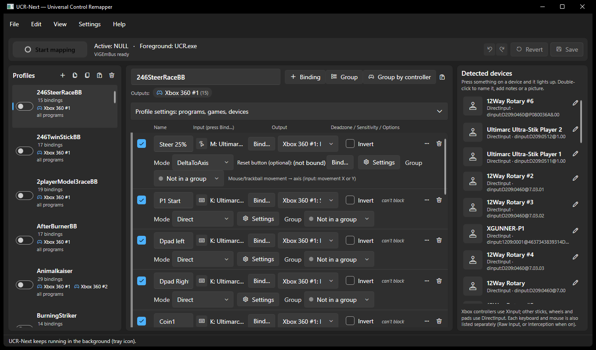
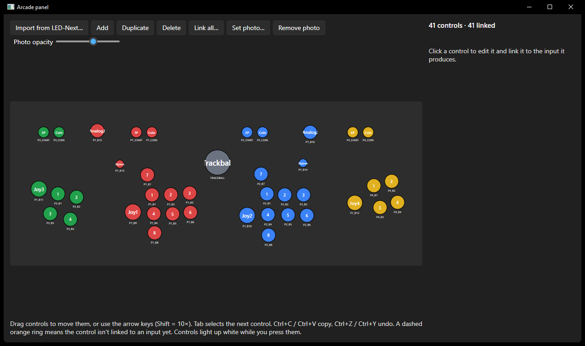

# UCR-Next

A maintained, from-scratch successor to evilC's **Universal Control Remapper (UCR)**. Great thanks to evilC and the work he put into making the original UCR, without it the emulation scene wouldn't be the same!
It remaps any input (gamepad, joystick, wheel, keyboard, mouse) to any output (keyboard, mouse,
a **virtual Xbox 360 controller** or **vJoy** joysticks), organised in profiles that are saved as JSON.
It can run silently in the background, start with Windows, and be controlled from the command line.

Windows 10/11 only.

> **Still in development** (version 0.13). UCR-Next runs in place of UCR on a 4-player arcade
> cabinet (installed as `UCR.exe`). It is not finished, though: expect rough edges and changes
> between versions, and keep your original UCR folder until you're happy.

## Screenshots
**Profiles and bindings:** every profile with its bindings, outputs and options, plus the detected devices.


**Arcade panel:** your control panel as it really looks (imported from LED-Next), with every control linked
to the input it sends.


## What UCR-Next improves on UCR
- **Actively maintained**, on .NET 8 and with automated tests. It has a Setup installer that bundles the .NET
  runtime, and a portable zip.
- **A drop-in replacement.** It ships a `UCR.exe` that understands `UCR.exe --profile "Parent,Child"`, so
  frontends and launch scripts keep working unchanged. It imports UCR's `context.xml` with all the standard
  and HidWizards plugins. Re-importing keeps what you've added since, and an import report lists anything
  that was approximated.
- **Several profiles at once.** UCR ran one profile at a time. Profiles can also switch on by themselves:
  - only while a given program is in front;
  - never while a given device is plugged in (e.g. your real wheel);
  - not until all of their controllers are connected.
- **Identical devices keep their identity.** Two identical spinners or sticks are told apart by USB serial
  number or USB port, not by the order Windows lists them in, so they no longer swap after a reboot.
- **Device slots and extra players.** Bindings read a named slot ("P1 stick") instead of one exact controller.
  Replace a stick and you change one setting, not every binding. Extra players replace UCR's shadow devices.
- **Per-device keyboards and mice without a driver** through Raw Input, including mouse, trackball and spinner
  movement. Interception is still supported when you need to block one device.
- **Safer states (shift layers).** A binding switched off by a state releases its output instead of freezing it.
  **Ctrl+Alt+Pause** always stops mapping, and keys are never left stuck.
- **No ghost controllers.** Virtual Xbox 360 and DualShock 4 pads are plugged in only while a profile uses them,
  in player order, and are unplugged when they're no longer needed, even if UCR-Next crashes.
- **Edit with confidence.** Changes apply at once so you can try them, but are saved only when you press
  **Save**. You get **Revert** and **Undo/Redo**. Profiles can be copied and pasted as text, duplicated and
  exported, and bindings can be sorted into named, coloured groups.
- **Know your devices.** Each device shows the product name it reports. A device lights up when you press
  something on it, and you can give it your own name, notes and picture.
- **Arcade panel view.** Import your panel from LED-Next, link each control by pressing it, watch controls light
  up live, and see or edit what each control does in any profile.
- **Built for cabinets and launchers:**
  - a `ucrnext.exe` command line (`status`, `solo`, `game "<name>"`, `start`, `stop`…) and a games list per profile;
  - background mode with a tray icon;
  - start with Windows, optionally as administrator.
- **Light and dark themes** that follow Windows.

**Download** from the [Releases](https://github.com/QROACHATHOME/UCR-Next/releases) page, then install
the drivers you need (see Requirements):

- **`UCR-Next-<version>-setup.exe`** (recommended): installs into `C:\Program Files\UCR-Next` with a
  Start-menu shortcut and an uninstaller. The program folder holds only about 25 files; if the
  Microsoft .NET 8 Desktop Runtime isn't installed yet, Setup installs it (it's bundled, no internet
  needed). Optional: desktop shortcut, start with Windows. Running Setup again upgrades in place and
  closes a running UCR-Next first. Uninstalling also removes the start-with-Windows entry; your
  profiles and settings in `%APPDATA%\UCR-Next` are kept.
- **`UCR-Next-<version>-win-x64.zip`** (portable): unzip anywhere and run `UCR-Next.exe` — no .NET
  install needed, because the runtime is in the folder (a few hundred files). Use this to
  [install in place of UCR](#replacing-ucrexe-frontends-keep-working) or on a PC where you can't run installers.

## Features

- **Inputs**
  - Xbox-compatible controllers through **XInput** (14 buttons, 4 stick axes, 2 triggers)
  - Other sticks, wheels, HOTAS, generic pads through **DirectInput**: up to 8 axes, 128 buttons,
    4 POV hats each (falls back to the WinMM joystick API if DirectInput is unavailable)
  - Keyboard and mouse buttons through low-level hooks ("any keyboard / any mouse")
  - **Mouse / trackball / spinner movement and the mouse wheel** through Raw Input — no driver
    needed, any mouse or one specific mouse (`rawmouse:VID:PID@…`)
  - **Per-keyboard keys** through Raw Input (`rawkbd:VID:PID@…`) — no driver needed, but read-only:
    the original key still reaches other programs. To block keys on one keyboard only, use Interception.
  - **Per-device** keyboards and mice through the optional **Interception** driver
- **Outputs**: keyboard, mouse buttons, mouse movement and **mouse wheel** (one notch per button press,
  or continuous scrolling from an axis; SendInput, scan codes), up to **four virtual Xbox 360** pads
  (P1–P4, ViGEmBus; plugged in in order so games number them correctly), up to **four virtual
  DualShock 4** pads (for games that want a PlayStation controller; numbered separately, they don't
  take an Xbox slot), **vJoy** devices 1–16 with axes, buttons and **POV hats** (pressing two
  directions gives the diagonal)
- **Bindings**: any input → any output, with deadzone, anti-deadzone, sensitivity (linear or UCR's
  curve), invert; analog → button past a threshold; button → axis with pressed/released values;
  **Toggle** (press for on, again for off) and **Pulse** (a fixed-length press on each press or release) for buttons
- **Binding modes** (*Mode* on the binding's second line, *Settings…* for all options):

  | Mode | What it does | UCR plugin |
  |---|---|---|
  | Direct | one input → one output (optionally only the high/low half of an axis) | Button/Axis to Button/Axis, Axis Splitter |
  | ButtonsToAxis | two buttons → one axis (+1 / -1 / centre) | Buttons to Axis |
  | StickPair | two axes as one stick: circular deadzone, rotation | Axes to Axes, Axes to Axes (Rotation) |
  | StickTrim | stick pair + trim button / reset trim | Axes to Axes (Trim) |
  | AxesRange | button while both axes are inside a box | Axes Range to Button |
  | DeltaToAxis | mouse/trackball movement → axis, absolute (returns to centre) or relative | Delta to Axis |
  | DeltaToButtons | movement → button per direction, with centre timeout and debounce | Delta to Buttons |
  | LongPress | short press and long press of one button → two outputs | Button to Buttons (Long Press) |
  | Increment | axis moves the output gradually | Axis to Axis Increment |
  | AxisMerger | two axes → one: average, greatest or sum (e.g. two pedals on one axis) | Axis Merger |
  | AxisToDelta | stick → mouse movement, Min–Max pixels per 10 ms | Axis to Delta |
  | DefaultValue | no input: an output axis starts at this value until something moves it | Axis Initializer |
  | FpvMix | roll and yaw mixed by a camera angle | FPV Angle Mix |
  | ReversibleThrottle | throttle drives half an axis; a button flips forward / reverse | Reversible Throttle |
  | SetState | a button (or an axis entering a range) switches a named state on, off or toggles it | Button / Axis to Filter |
- **States (shift layers)**: a *SetState* binding switches a named state such as `shift`; any binding can be
  limited to *Only while states* `shift` (or `!shift` = while off) in its *Settings*. One button can then do
  different things with and without a shift button held, or with a "menu" state toggled on. Each profile
  has its own states; a binding that is switched off by a state releases its output.
- **Blocking**: tick *Block* on a keyboard/mouse binding and the original key/button no longer
  reaches other programs while mapping is on (any device via hooks, one device via Interception)
- **Per-application profiles**: list programs (e.g. `game.exe`) on a profile and it is only active
  while one of them is in the foreground; profiles without programs are always active
- **Skip while a device is connected**: e.g. a "pad as steering wheel" profile stays off — and creates
  no virtual controller — while your real wheel is plugged in
- **Device slots** (*Settings → Device slots and extra players…*): bindings read a named slot such as
  "P1 stick" instead of one exact controller, and the slot says which controller fills it. Replace a
  stick or let Windows renumber it and you change one setting instead of every binding (a slot also
  finds its controller by name if its id changed). Binding a control of a slot's controller uses the
  slot automatically; the dialog can switch existing bindings over.
- **Extra players** (UCR's shadow devices): give a slot extra controllers for players 2–4 and every
  binding that reads it also runs for each of them, driving the next virtual pad / vJoy device
  (player 2 → Xbox 360 #2) with its own states. A player's copy only runs while that controller is
  connected, so no virtual pad is plugged in for a missing controller.
- **Wait until its controllers are connected** (per profile): the profile stays off until every
  controller its bindings read is plugged in, so a virtual pad never takes an Xbox slot ahead of a
  real pad that's still missing.
- **Games list per profile**, plus `ucrnext game "<name>"` to switch to the right profile from a launcher
- **UCR import**: *File → Import UCR profiles* reads UCR's `context.xml` (see below)
- **Background mode**: tray icon (optional), start hidden at Windows logon, optionally as administrator
- **Command line**: `ucrnext.exe status | start | stop | enable <profile> | solo <profile> | …`
- **Save, Revert, Undo**: edits take effect at once so you can try them, but are only written to disk
  when you **Save** (Ctrl+S). **Revert** goes back to the saved profiles; **Undo / Redo** (Ctrl+Z / Ctrl+Y)
  step through your edits (a Revert or a deleted profile can be undone too). Closing with unsaved edits asks
  first. Switching a profile on or off is not an edit: it applies and is saved at once.
- **Copy, paste, duplicate, delete profiles**: the buttons above the profile list, its right-click menu,
  or Ctrl+C / Ctrl+V / Ctrl+D / Del. Profiles and bindings are copied as text, so you can also paste them
  into a message to share them, or use *File → Export / Import profile*. Copies start switched off.
  Deleted profiles are moved to the profiles folder's `deleted` subfolder when you save.
- **Groups**: sort a profile's bindings into named, coloured groups (e.g. *Player 1 pad*, *Keyboard*).
  *+ Group* makes one, each binding's *Group* box moves it, *Group by controller* sorts every ungrouped
  binding by its input device. Groups fold away, can be reordered, and copied into other profiles.
- **Recognise your devices**: keyboards and mice show the product name they report (e.g. *I-PAC 2*)
  instead of only VID:PID. A device lights up in *Detected devices* when you press something on it.
  Double-click a device to give it your own name, notes and a picture (choose a file or paste one);
  the name and picture also appear on bindings and in *Group by controller*. Devices you never use
  can be hidden. Stored in `settings.json`; pictures are copied to `%APPDATA%\UCR-Next\device-images`.
- **Light and dark themes**: *View* menu — follow Windows (default), light or dark; uses the Windows accent colour
- **Safety**: **Ctrl+Alt+Pause** always stops mapping and blocking; keys are never left stuck
  when bindings change, profiles switch, or mapping stops

## Requirements

| What | Needed for | Where |
|---|---|---|
| **.NET 8 SDK** (build) / .NET 8 Desktop Runtime (run) | everything | `winget install Microsoft.DotNet.SDK.8` |
| **ViGEmBus** | virtual Xbox 360 output | https://github.com/nefarius/ViGEmBus/releases |
| **vJoy** | vJoy output | https://github.com/jshafer817/vJoy/releases (configure devices with *Configure vJoy*) |
| **Interception** | per-device keyboard/mouse, blocking one device only | https://github.com/oblitum/Interception/releases |

None of the drivers are bundled; every one is optional. Missing drivers are reported in
*Help → Driver and device status* and in `ucrnext status`, and the rest of the app keeps working.

### Installing Interception (optional)

1. Download `Interception.zip` from the releases page and unzip it.
2. In an **administrator** command prompt: `"command line installer\install-interception.exe" /install`, then **reboot**.
3. Copy `library\x64\interception.dll` next to `UCR-Next.exe`
   (or set `InterceptionDllFolder` in `%APPDATA%\UCR-Next\settings.json`).
4. In UCR-Next: *Settings → Use Interception driver*, then restart UCR-Next.

Interception is a kernel filter driver; while UCR-Next runs with it, every key press passes through
UCR-Next. It is built to always pass input on if anything goes wrong, and if UCR-Next exits or
crashes the driver lets input through again. Known driver limitation: after many hundreds of
device re-plugs without a reboot it can stop seeing new devices — reboot to fix.

## Build and run

```powershell
cd "D:\My AI projects\UCR-Next"
dotnet build
dotnet test
dotnet run --project src\UcrNext.App
```

Release build into one folder (contains `UCR-Next.exe` and `ucrnext.exe`):

```powershell
dotnet publish src\UcrNext.App -c Release -o publish
```

### Making a release

Bump `<Version>` in `Directory.Build.props`, commit, then tag and push the tag:

```powershell
git tag v0.5.0
git push origin v0.5.0
```

GitHub Actions (`.github/workflows/release.yml`) runs the tests, then `build\Build-Release.ps1`, and
publishes `UCR-Next-0.5.0-setup.exe` and `UCR-Next-0.5.0-win-x64.zip` on a new release with notes
generated from the commits.

The same script builds both downloads locally into `dist\`:

```powershell
winget install JRSoftware.InnoSetup      # once; the installer is an Inno Setup script (build\UCR-Next.iss)
.\build\Build-Release.ps1                # version from Directory.Build.props
.\build\Build-Release.ps1 -SkipInstaller # zip only
```

It downloads Microsoft's .NET 8 Desktop Runtime installer once (cached for 30 days in
`%LOCALAPPDATA%\UCR-Next-build`, signature-checked) and bundles it into Setup.

### Startup options (`UCR-Next.exe`)

| Option | Effect |
|---|---|
| `--background` | start without showing the window |
| `--start` | turn mapping on immediately |
| `--no-tray` | no tray icon (control it with `ucrnext.exe`) |
| `--profiles DIR` | use another profile folder |

Only one instance runs per user. Launching it again shows the existing window (or, with `--start`,
turns mapping on) and exits.

## Command line: `ucrnext.exe`

`ucrnext.exe` sits next to `UCR-Next.exe` and talks to the running instance over a per-user named pipe.

```
ucrnext status                 mapping state, active profiles, foreground app, drivers, devices
ucrnext start | stop | toggle  turn mapping on / off
ucrnext profiles               list profiles ([x] = enabled, apps they are limited to)
ucrnext enable <profile>       enable a profile   (case-insensitive, unique prefix is enough,
ucrnext disable <profile>      disable a profile   quote names with spaces)
ucrnext solo <profile>         enable only this profile
ucrnext ucr "Parent,Child"     like UCR.exe --profile: only that profile, mapping on
ucrnext games                  list games and the profiles they use
ucrnext game <game> [--start]  enable only the profile(s) listing this game (exact, or unique partial name)
ucrnext import <context.xml> [--per-device]   import UCR profiles (works even when UCR-Next is closed)
ucrnext save                   save edits made in the window
ucrnext reload                 reload profiles from disk (after editing the JSON by hand; drops unsaved edits)
ucrnext show | hide            show or hide the window
ucrnext quit [--save|--discard]  exit UCR-Next (with unsaved edits it refuses unless told what to do with them)

ucrnext launch [--background] [--start]           start UCR-Next if it is not running
ucrnext autostart [status|off|logon|elevated]     start with Windows
```

Exit code 0 = OK, 1 = error or UCR-Next not running, 2 = usage error. Handy for scripts,
launchers (e.g. HyperSpin/RocketLauncher pre-launch commands) and Stream Deck buttons:
`ucrnext solo "Racing Wheel" && ucrnext start`.

## Arcade panel (View → Arcade panel…, F2)

Your control panel as it really looks, for linking and checking controls at the cabinet:

- **Import from LED-Next…** reads LED-Next's `cabinet.json` (in LED-Next's `config` folder): every
  control with its id (`P1_B1`, `P2_START`…), label, player, kind, position and the panel photo, so you
  don't draw the panel twice. Importing again after moving buttons in LED-Next keeps the links you made here.
- Or build it here: **Add**, drag, arrow keys to nudge (Shift = 10×), Tab to step through the
  controls, Ctrl+D / Ctrl+C / Ctrl+V, Ctrl+Z / Ctrl+Y, Esc to deselect, **Set photo…** and the photo opacity.
- **Link** each control to the input it produces: select it and press *Link…*, then press it on the
  real panel. **Link all…** goes through every control that isn't linked yet, player by player. A
  joystick asks for up, down, left and right; a spinner for one turn (per device, so two identical
  spinners are told apart); a trackball for left/right and up/down. Controls that aren't linked yet
  have a dashed orange ring.
- **Live view**: controls light up white while you press them, so a miswired or wrongly linked
  control shows at once.
- **Profile view**: pick a profile at the top and every linked control is labelled with what it does
  in that profile (`A`, `Z`, `LeftX`, `Wheel Down`…; hover for the full list). Select a control to
  change its output or open its settings, or press **Add binding** if it does nothing yet: the new
  binding reads that control and its output list opens. Double-click a control does the same.
  Ctrl+S (or **Save profiles**) saves, like Save in the main window.

The panel is saved as `panel.json` (photo in `panel-images`) in `%APPDATA%\UCR-Next`, at once after
each change. Moving or linking controls never changes bindings; only the profile view's output and
Add binding do.

## Identical devices (two spinners, two sticks)

Each joystick, mouse and keyboard gets an id made of its vendor and product number plus a key
for that one physical device, e.g. `rawmouse:1241:1111@P3A1B2C4D`:

- `@` followed by the device's **USB serial number**, if it reports one. The id is then the same in
  every USB port.
- `@P…`: no serial number (common for spinners and encoders), so the key comes from the **USB port**
  the device is plugged into. The id is the same as long as the device stays in that port.

So two identical spinners keep their identity however Windows happens to list them, after reboots
and after unplugging. (UCR, and UCR-Next before 0.10, numbered them `#1`, `#2` in the order Windows
listed them, so they could swap.) Moving a device without a serial number to another port makes it
show up as a new device instead of taking the other one's place. A device slot (*Settings → Device
slots*) is the quickest way to point your bindings at it again.

Older ids such as `dinput:VID:PID#2` (from earlier versions and from UCR imports) still work: they
mean the n-th of the identical devices in key order. Bind again, or use a device slot, to get the
stable id. After updating, check once that identical devices are the right way round.

## Profile settings: programs, games, devices

Expand **Profile settings** above the bindings list:

- **Only active while these programs are in front** — `game.exe, emulator.exe`; empty = everywhere.
- **Games that use this profile** — one per line, free text. Shown in the profile list and used by
  `ucrnext game "Daytona USA" --start`, which enables exactly the profile(s) listing that game.
  Handy as a launcher pre-launch command (HyperSpin/RocketLauncher, LaunchBox, Playnite…).
- **Skip this profile while connected** — *Add connected device* picks a plugged-in controller.
  While any listed device is connected the profile is inactive and no virtual controller is created for
  it. Devices are matched by id (see *Identical devices* below) or by name. `ucrnext status` shows "Skipped (device connected)".
- **Wait until its controllers are connected** — see above; `ucrnext status` shows "Waiting for their controllers".

### Virtual pads and leftover ("ghost") controllers

UCR-Next plugs virtual pads in only while an active profile uses them and unplugs them when it no
longer needs them, when mapping is switched off and when it closes. If UCR-Next crashes or is killed,
the ViGEmBus driver unplugs its pads by itself, because they belong to UCR-Next's connection to the
driver. Nothing is left behind, and a missing controller never creates anything.

## Importing UCR profiles

UCR keeps everything in `context.xml` in the folder where `UCR.exe` is. Copy that file to this PC and
use *File → Import UCR profiles…*, or `ucrnext import path\to\context.xml`.

- Every UCR profile becomes a UCR-Next profile; child profiles are flattened into
  "Parent › Child" with the parent's mappings (child mappings with the same name override them).
- Imported profiles start **disabled** (UCR ran one profile at a time) — tick the ones you want,
  or use `ucrnext solo <profile>` / `ucrnext game <game>`.
- Re-importing the same file updates the bindings and keeps the games, programs, device rules and
  enabled state you added in UCR-Next.
- An import report lists everything that was approximated or skipped.

| UCR | UCR-Next |
|---|---|
| Inputs: XInput, DirectInput (VID/PID + instance), Interception keyboard keys, mouse buttons, mouse movement and wheel | same devices; keyboard/mouse become "any keyboard/mouse" unless you choose per-device — then Interception ids if Interception is running (can block), otherwise Raw Input ids (no driver, can't block; the report lists bindings that blocked in UCR) |
| Inputs with shadow devices | a device slot named after the device, with the shadow devices as extra players (the report notes output shadow devices that aren't simply the next pad / vJoy device) |
| Outputs: ViGEm Xbox 360 and DualShock 4 pads 1–4, vJoy axes/buttons/POV hats, Interception keyboard keys / mouse buttons / mouse movement | virtual Xbox 360 pads P1–P4, DualShock 4 #1–#4, vJoy, SendInput |
| Plugins: Button to Button, Axis to Axis, Axes to Axes, Axis to Button, Button to Axis, Buttons to Axis, Axis Splitter, Axis Merger, Axis Initializer, Button to Event, Button to Filter, Axis to Filter, and HidWizards/UCR-Plugins: Axes to Axes (Rotation), Axes to Axes (Trim), Axes Range to Button, Axis to Axis Increment, Button to Buttons (Long Press), Delta to Axis, Delta to Buttons, Axis to Delta, Event to Button, FPV Angle Mix, Reversible Throttle | converted to the binding modes above with the same maths as UCR (deadzones incl. circular, anti-deadzone, UCR's sensitivity curve, full-range triggers, timers) |
| Block flag on inputs | *Block* on keyboard/mouse bindings |
| Plugin filters | *Only while states* on the bindings; Button/Axis to Filter become *SetState* bindings. Unlike UCR, a binding switched off by a state releases its output instead of freezing it |
| Events | mouse wheel up/down/left/right: Button to Event → wheel output (one notch per press/release), Event to Button → a pulse of the hold time |
| Not converted (reported) | unknown third-party plugins |

## Replacing UCR.exe (frontends keep working)

Frontends and launch scripts that start the original UCR with a profile keep working unchanged:

```
UCR.exe --profile "Parent,Child"      (also -p, /p, --profile=…, -p:…)
```

UCR-Next ships a copy of itself named `UCR.exe` that understands this. As UCR does, the name is
matched without regard to case, a comma separates a child profile from its parent, and if the
child isn't found the deepest profile that matched is used. UCR-Next then enables only that
profile, turns mapping on and stays in the background (tray), so no window pops up over the game.
If UCR-Next is already running, the new `UCR.exe` passes the request to it and exits, as UCR does.
Closing or killing `UCR.exe` stops mapping, and its virtual pads are unplugged.

**Install in place of UCR**

1. Close UCR.
2. Rename UCR's folder, e.g. `C:\UCR` → `C:\UCR-original`. Nothing in it is changed or deleted.
3. Unzip UCR-Next (the portable zip) into a new folder with the old name (`C:\UCR`). It contains `UCR.exe`.
   (Setup also works: choose `C:\UCR` as the install folder. An installed UCR-Next has `UCR.exe` too.)
4. Copy `context.xml` from `C:\UCR-original` into `C:\UCR`. The first time a profile is asked for
   that UCR-Next doesn't have, it imports this file once and tries again. You can also import it
   yourself (*File → Import UCR profiles…*), for example to choose per-device keyboards.
5. Test it with `C:\UCR\UCR.exe -p "Your profile"`, then `ucrnext status`.

**Roll back:** exit UCR-Next (tray icon → Exit, or `ucrnext quit`), rename `C:\UCR` to `C:\UCR-Next`
(or delete it), and rename `C:\UCR-original` back to `C:\UCR`. UCR-Next's own profiles and settings
live in `%APPDATA%\UCR-Next`, not in the program folder, so both stay as they were.

## Running in the background / with Windows

*Settings → Start with Windows (hidden)*, or `ucrnext autostart …`:

- **At logon**: adds `UCR-Next.exe --background --start` to your user's Run key. No admin needed.
- **At logon, as administrator**: creates a Task Scheduler task (logon trigger, highest privileges,
  no time limit, runs on battery). One UAC prompt. Choose this if your games run as administrator —
  Windows does not let a normal program send input to an elevated one. When it runs elevated,
  run `ucrnext` from an elevated prompt as well.

**Why not a Windows service?** Services run in an isolated session (session 0) that has no access to
your keyboard, mouse, or desktop, so a service can neither read your physical input nor send
key presses to your games. The logon task gives the same "always on, no window" behaviour while
running on your desktop where remapping works.

Related settings: *Start mapping when UCR-Next starts*, *Show tray icon*, *Keep running in the tray
when the window is closed*. Settings are stored in `%APPDATA%\UCR-Next\settings.json`.

## Quick start

1. Plug in your controller; it appears under **Detected devices**.
2. **+ Binding**, press **A** on the pad, choose **Key: Space** as output.
3. **+ Binding**, push the left stick fully right, choose **Xbox 360: LeftX** (or a vJoy axis).
   Raise *Deadzone* (first slider) to about 0.15 if the stick drifts.
4. Optional: type `game.exe` under *Only active while these programs are in front*, or use
   *Add running program*.
5. **Start mapping** and try it. Check the virtual pad in `joy.cpl`.
6. **Save** (Ctrl+S) when you're happy, or **Revert** to go back to what was saved.

## Project layout

```
src/UcrNext.Core      engine (net8.0, no Windows deps): model, axis shaping, MappingEngine
                      (per-app filter, blocking, Xbox/vJoy aggregation), EngineRunner (250 Hz),
                      ProfileStore, AppSettings, CommandProcessor + named-pipe transport
src/UcrNext.Devices   Windows: XInput, DirectInput (Vortice), WinMM fallback, keyboard/mouse hooks,
                      Interception, SendInput, ViGEm, vJoy, foreground watcher, autostart
src/UcrNext.App       WPF UI (Fluent look via WPF-UI), tray icon, background mode, single instance, pipe server
src/UcrNext.Cli       ucrnext.exe
tests/UcrNext.Core.Tests  xUnit tests (engine, per-app, blocking, vJoy, commands, storage)
```

## Known limitations

- Blocking applies to keyboard keys and mouse buttons, not to gamepads (that would need HidHide).
- "Any keyboard" key mappings don't fire while UCR-Next's own window has focus (Windows stops
  feeding the keyboard hook to a program that registered Raw Input keyboards while it is in front).
  Press-to-bind is not affected, and games/other programs in front work normally.
- Press-to-bind writes what it saw to `%LOCALAPPDATA%\UCR-Next\bind-debug.log` — attach it when
  reporting a binding problem.
- Third-party XInput pads may appear twice (XInput and DirectInput); bind the XInput one.
- DirectInput reports only the axes a device exposes to DirectInput, which can be fewer than vJoy's
  own configuration shows.
- No plugin system yet.

## License

MIT — see [LICENSE](LICENSE). UCR-Next contains no code from UCR; UCR's open-source code was only read to understand its `context.xml` format and plugin behaviour so profiles import faithfully. Third-party drivers (ViGEmBus, vJoy, Interception) are not included and keep their own licenses.
